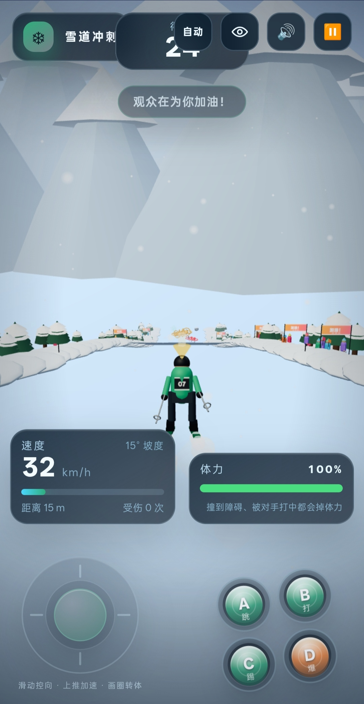
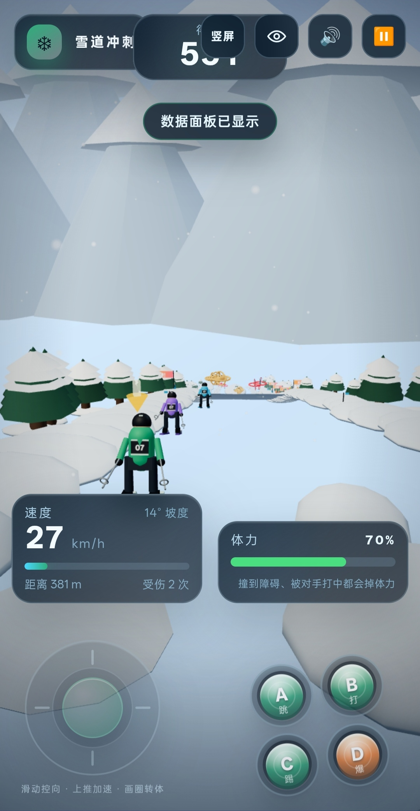
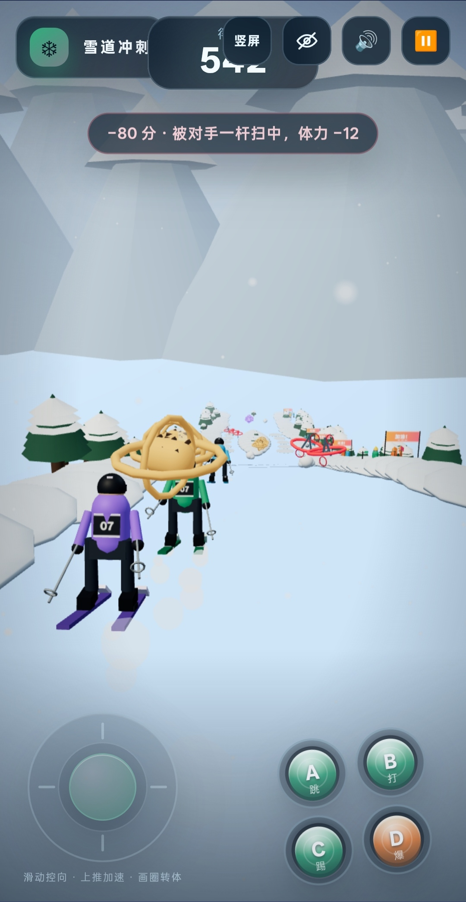
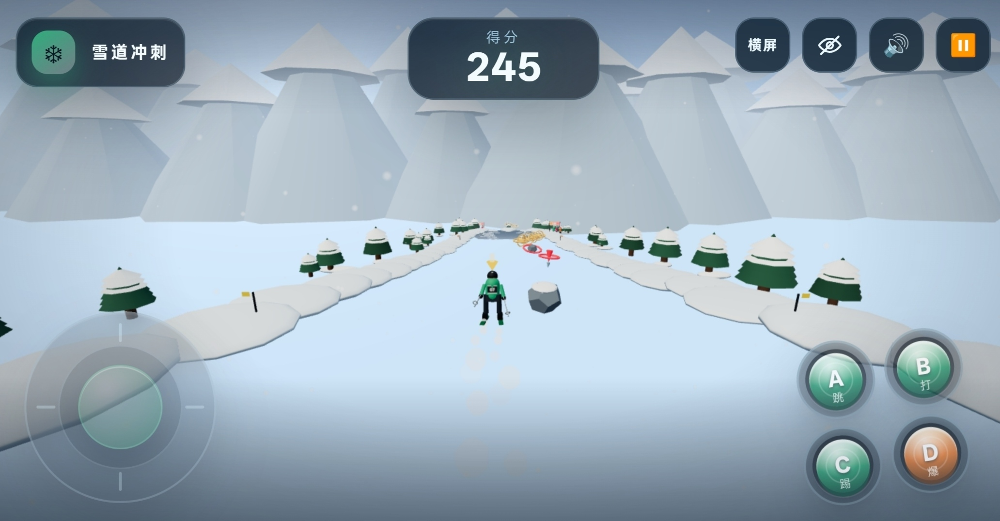

# 雪道冲刺 · POWDER RUSH

一个用 **Vue 3 + TresJS 5 + Three.js** 制作的 3D 无限滑雪小游戏。

从雪山顶冲下去，用方向键控制方向和速度，避开雪团、岩石、倒木和雪松。撞到障碍会掉体力并扣分，体力耗尽就翻车。雪道无限延伸，坡度会随距离变化；两侧偶尔出现挥舞手臂、跳动的观众和“加油！”横幅。

## 特性

- 🎿 程序化低模滑雪员，6 套滑雪服配色可实时切换
- 🏔 无限雪道：分段生成、随机起伏坡度、雪松 / 雪堤 / 小木屋 / 雪山背景
- 🕹 左右转向、上下加速刹车；支持键盘和移动端触屏
- 🦘 空格大跳，可越过雪团、岩石和倒木；移动端有独立「跳」按钮
- ⛄ 随机障碍：雪团、岩石、倒木、雪道上的雪松
- 💥 碰撞掉体力 + 扣分，有雪爆、屏幕震动、白闪和音效
- 👏 路边观众有挥手、蹦跳、举旗和“加油！”横幅，靠近时欢呼
- ❄️ 双层飘雪、风声、雪面摩擦声、撞击声和观众欢呼，全部 WebAudio 合成
- 🏆 距离得分、每 250 m 额外加分、最高分本地保存
- 📱 桌面 / 手机自适应，移动端显示大号触控按钮

## 操作

| 按键              | 作用                           |
| ----------------- | ------------------------------ |
| `←` `→` / `A` `D` | 左右转向                       |
| `↑` `↓` / `W` `S` | 加速 / 刹车                    |
| `Space`           | 大跳（可越过雪团、岩石和倒木） |
| `Esc` / `P`       | 暂停                           |
| `R`               | 结算界面再来一局               |
| `M`               | 静音开关                       |

手机上使用屏幕底部的方向按钮，底部正中间的圆形「跳」按钮负责起跳；开始页可以选择滑雪服颜色，选择会立即同步到 3D 滑雪员。

## 开发

```sh
pnpm install
pnpm dev
```

质量检查：

```sh
pnpm type-check
pnpm lint
pnpm test:unit -- --run
pnpm build
```

## 目录结构

- `src/views/SkiGameView.vue` — 开始页、HUD、暂停、结算、触控
- `src/components/SkiCanvas.vue` / `SkiWorld.ts` — TresJS 画布与世界生命周期
- `src/game/SkiRun.ts` — 物理、输入、碰撞、计分、镜头、障碍与无限分段
- `src/game/world.ts` — 雪道网格、松树、观众、横幅、障碍、木屋
- `src/game/skier.ts` — 程序化滑雪员与动作
- `src/game/terrain.ts` — 连续随机坡度的高度函数
- `src/game/audio.ts` — 风声、雪声、撞击、欢呼、里程碑音效
- `src/game/effects.ts` — 围绕镜头的飘雪与雪雾粒子
- `src/stores/ski.ts` — 配色、静音、最高分持久化

## 截图如下






## 在线链接地址

[点击试玩](https://skiing-24g.pages.dev '链接地址')
